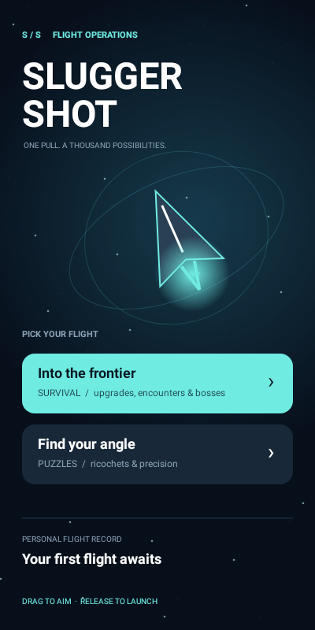
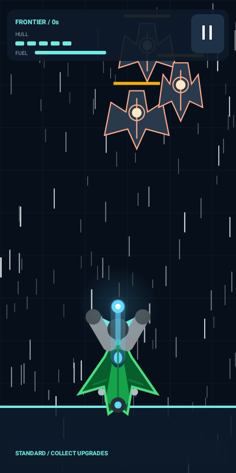

# Sluggershot — Frontier experience pass (v34 / app version 0.2)

This edition retains the native Android Canvas gameplay and the combat and
bank-shot puzzle modes, with a new flight-deck presentation and deliberate
transitions between playing, pausing, results, and a new flight.

## Downloads and previews

- [Install the debug APK](https://github.com/BaconBaps/playpen/raw/refs/heads/master/downloads/Sluggershot_v34_Frontier_debug.apk)
- [Download the full project ZIP](https://github.com/BaconBaps/playpen/archive/refs/heads/master.zip)

This is a debug-signed development build. If your previous installation was signed
with a different debug key, Android will require uninstalling it first.




## What changed

- Clean vector enemy ships and glowing puzzle beacons replace the visible
  logo/text fragments in the original enemy textures.
- Navy, teal, and white visual system with a ship illustration, custom launcher
  icon, responsive menu cards, and a compact flight HUD.
- Each mode opens a pre-flight briefing. Gameplay stays frozen until Launch.
- A pause button and Android Back pause gameplay. App backgrounding also pauses
  simulation and audio; returning to the app requires Resume.
- Defeat presents flight time, volley count, a personal survival record, and an
  explicit retry. Boss checkpoint retries remain available.
- Completing a puzzle presents a result. Next sector generates the next layout
  and presents its briefing; the game no longer advances without the player.
- New flights reset health, boss state, upgrades, ammunition, and launcher
  position. Flight deck returns to mode selection.
- The development row that granted upgrades for free is removed from gameplay.
  Upgrades must be collected. Available bombs have a dedicated HUD button;
  the existing triple-tap bomb gesture also remains supported.

## Play

Drag down and release to shoot up; diagonal drags aim in the opposite direction.
In combat, slide two fingers to move the ship. Hold a finger still to thrust.
Collect upgrades, manage fuel, and survive boss encounters.
In puzzles, bank shots against the chamber walls to destroy all targets.

## Build

Open the project in Android Studio with Android SDK Platform 35 and JDK 21.
Set your SDK path through Android Studio (local.properties is machine-specific).
Use the included Gradle wrapper:

```
./gradlew :app:assembleDebug
./gradlew :app:testDebugUnitTest :app:lintDebug
```

The debug APK appears at app/build/outputs/apk/debug/app-debug.apk.
Tests exercise menu input, pause, retry, checkpoint recovery, puzzle progression,
mode reset, and layouts at multiple display sizes. They also save rendered screen
images under app/build/flight-previews. These run with Robolectric native graphics;
they do not replace testing camera-independent gameplay, audio, touch feel, and
performance on a physical Android device.

The downloadable source archive excludes Gradle caches, IDE state, build outputs,
and machine-specific local.properties. Original assets and their license remain. Earlier development notes are in docs/history.

## Validation of this edition

The debug APK was built and its signature verified. Nine automated tests passed,
including firing a projectile, pausing from the HUD, mode reset, puzzle progression,
and checkpoint retry. Android lint completed with zero errors and 21 warnings.
Physical-device audio, performance, and control feel are not yet validated.
