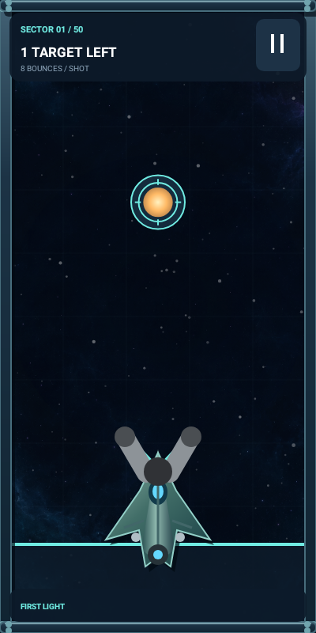
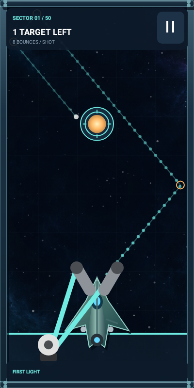
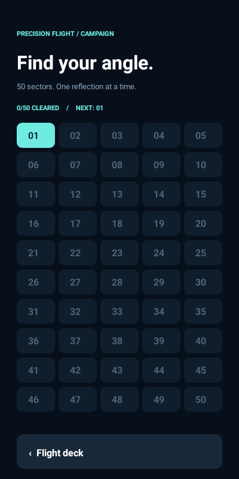

# Sluggershot — 50-sector puzzle campaign

A native Android space slingshot game with survival combat and a graduated,
50-level ricochet puzzle campaign. App version 0.3 / version code 3.

## Download and play

- [Download the Android debug APK](https://github.com/BaconBaps/playpen/raw/refs/heads/master/downloads/Sluggershot_debug.apk)
- [Download the Android Studio project ZIP](https://github.com/BaconBaps/playpen/archive/refs/heads/master.zip)

Install the APK on Android 8.0 or newer. This is a debug-signed development build.
If an earlier install used a different signing key, Android requires uninstalling
that build first. The new APK uses the same signing key as this repo's previous
v0.2 APK, so that version can be updated without losing its saved records.

## Puzzle campaign

Choose **Find your angle** on the flight deck to open the 50-sector selector.
Complete a sector to unlock the next; your unlocks and completed sectors save
between sessions. Any unlocked sector can be replayed.

The first level has one large, directly reachable target on one screen, no internal
obstacles, eight allowed reflections, and a long ricochet guide. Later levels add
length, targets, ledges and pillars; targets shrink, bounce budgets tighten, and
the guide becomes shorter. Layouts repeat on replay rather than rerolling randomly.

| Sectors | Chapter | Chamber length (screens) | Targets | Bounces per shot | Guide length (screens) |
| --- | --- | --- | --- | --- | --- |
| 01–05 | First light | 1.0 | 1–2 | 8 | 2.7 |
| 06–10 | First reflections | 1.0 | 2–3 | 7 | 2.2 |
| 11–15 | Cross currents | 1.15–1.25 | 3–4 | 6 | 1.8 |
| 16–20 | Orbital gates | 1.4–1.5 | 4–5 | 6 | 1.5 |
| 21–25 | The long way | 1.7–1.8 | 5–6 | 5 | 1.25 |
| 26–30 | Split horizons | 2.0–2.1 | 6–7 | 5 | 1.0 |
| 31–35 | Narrow passage | 2.35–2.45 | 7–8 | 4 | 0.85 |
| 36–40 | Deep reflections | 2.7–2.8 | 8–9 | 4 | 0.7 |
| 41–45 | The gauntlet | 3.1–3.2 | 9–10 | 3 | 0.6 |
| 46–50 | Final approach | 3.5–3.6 | 10–11 | 3 | 0.5 |

Guide lengths are maximum assistance distances. The preview stops at the first
beacon it would hit, or when the shot exceeds its reflection allowance. It uses
the same circular projectile/wall collision code as gameplay, including shot
radius, with small simulation steps. Amber rings mark predicted reflections.

Drag down to fire up; diagonal drags shoot in the opposite direction. Destroy all
beacons to complete the sector. There is no time limit or finite shot inventory.
The bounce allowance applies to each projectile, not the whole level: a shot can
survive the displayed number of reflections and breaks on the next wall contact.
Only one puzzle projectile is active at a time. **Recall** cancels a missed shot
and brings the camera back without resetting targets. The pause menu offers
**Retry this sector**. Clearing sector 50 ends the campaign and offers replay.





## Visuals and game flow

The renderer remains Android Canvas. A generated nebula artwork layer, subdued
parallax and vignette, quieter puzzle stars, metallic ship shading, and beveled
wall surfaces add atmosphere and depth. Clean enemy silhouettes and luminous
beacons replace the logo/text fragments in the original enemy textures.

Both modes have pre-flight instructions, pause/resume, and deliberate results.
Android Back pauses a flight; app backgrounding pauses simulation and audio.
Combat keeps its collectible upgrades, thrusters, fuel, bosses, and checkpoints.
The old development controls that granted upgrades for free are removed.

## Build and test

Open the repository root in Android Studio. Use JDK 21 and Android SDK Platform 35.
Configure your SDK path through Android Studio; local.properties is not committed.

```sh
./gradlew :app:assembleDebug
./gradlew :app:testDebugUnitTest :app:lintDebug
```

The built APK is app/build/outputs/apk/debug/app-debug.apk. Tests use Robolectric
native graphics and write screen renders under app/build/flight-previews.

This build passed 16 automated tests; Android lint reported zero errors and 23
warnings. Validation includes all 50 layouts: every target can be reached within its level's
bounce allowance, with overlapping target paths handled in clearable order. Tests
also cover the actual first-level firing/completion flow, save/reload, locked level
selection, recall, replay/reset, ending at level 50, and the original combat flows.
These checks verify reachability and progression; difficulty, performance, audio,
and touch feel still need physical-device playtesting.

The nebula artwork was generated for this project. Original imported assets and
their license are retained; earlier development notes are under docs/history.
